<div align="center">


# Campus Companion

**Announcements, tasks and administration for university life, in one Flutter app.**

[](https://github.com/Marzouki-Sami/campus-companion-app/actions/workflows/ci.yml)


[](LICENSE)

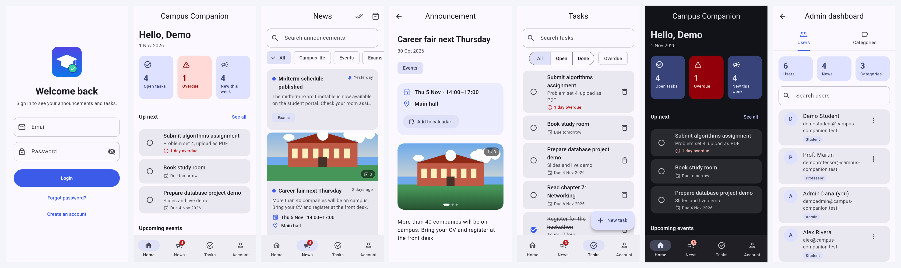

</div>

## Features

| Area | Highlights |
| --- | --- |
| **Dashboard** | Personal greeting, open/overdue task counters, next tasks and the latest announcements at a glance |
| **Announcements** | Category chips, full-text search, time-range filter; professors and admins can publish, edit and delete, and attach up to 8 photos shown as a swipeable carousel with a full-screen, pinch-to-zoom viewer |
| **Tasks** | Due dates with relative wording ("Due tomorrow", "3 days overdue"), status and overdue filters, search, pull-to-refresh |
| **Administration** | Tabbed dashboard to manage users (role, suspension, name, account deletion) and announcement categories |
| **Accounts** | Email/password sign-up with **email verification** (6-digit code), a strong-password policy with a live checklist, **forgot-password** by emailed code, profile editing |
| **Account safety** | Suspended or deleted accounts are blocked at sign-in, signed out when the app resumes, and denied by the database; breached passwords are refused |
| **Appearance** | Light, dark or system theme, remembered on the device |

Access control is enforced **in the database** with Postgres Row Level Security, not only in the UI. New accounts are always created as `student`, and only an admin can change a role.

## Screenshots

<table>
  <tr>
    <td>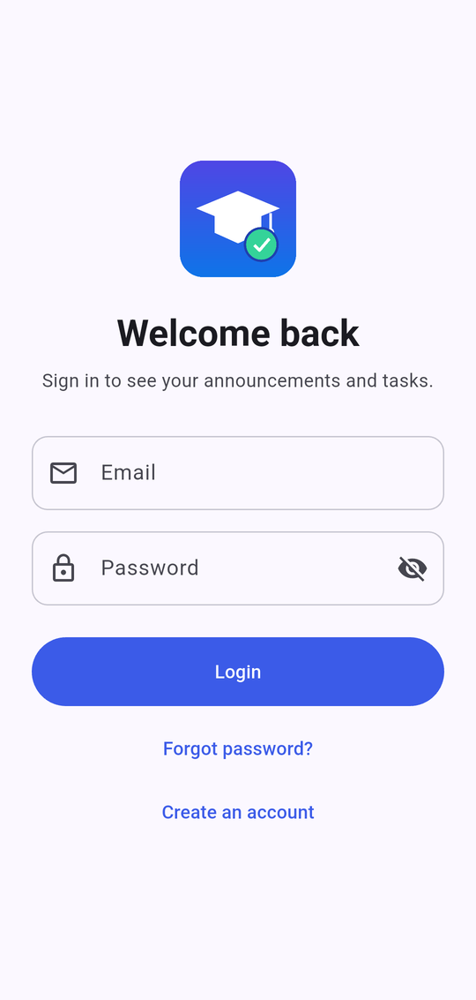</td>
    <td>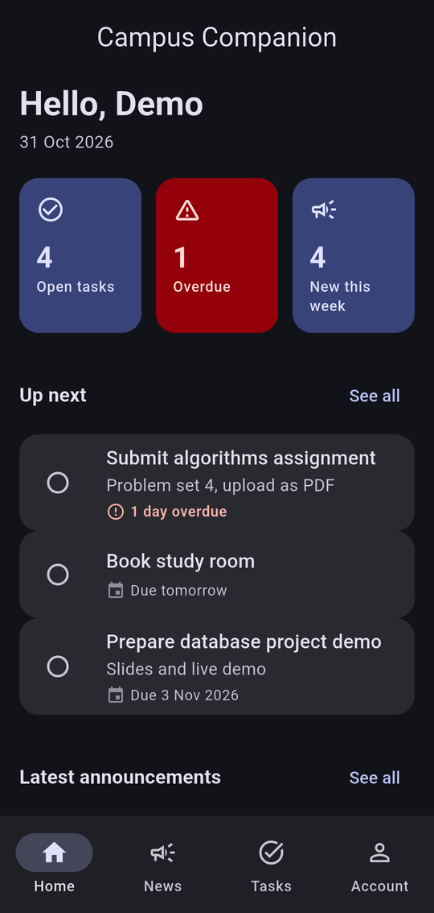</td>
    <td>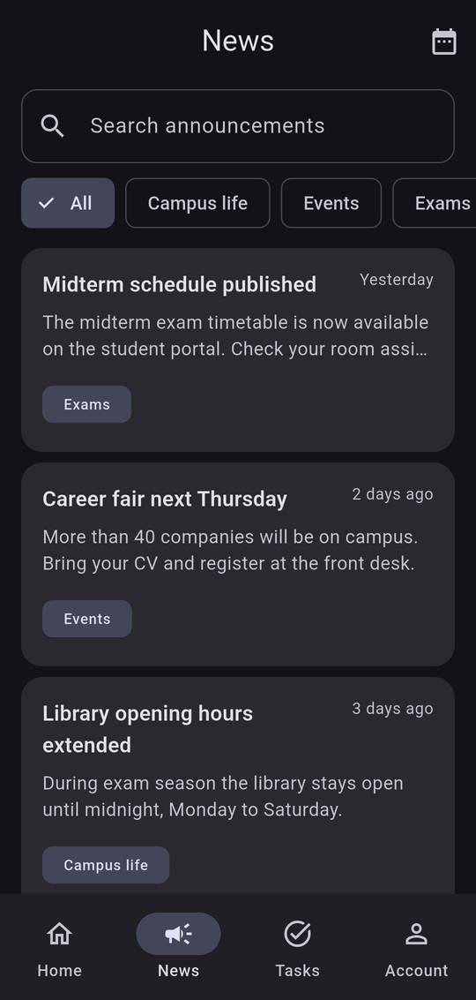</td>
    <td>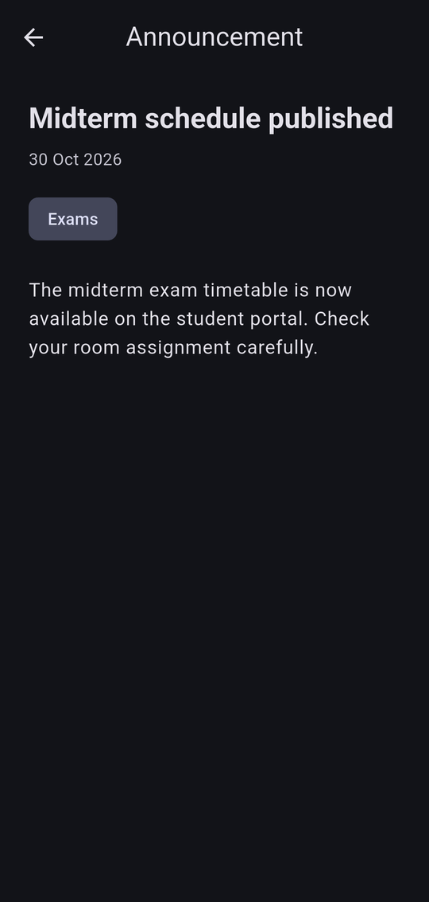</td>
  </tr>
  <tr>
    <td>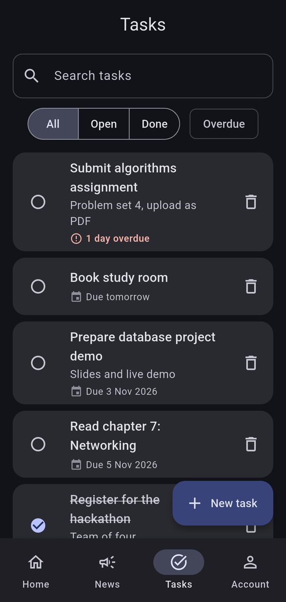</td>
    <td>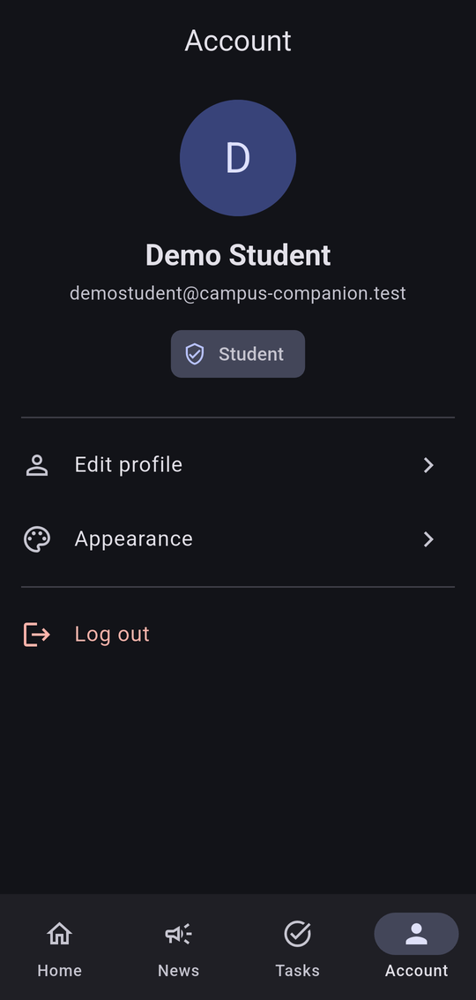</td>
    <td>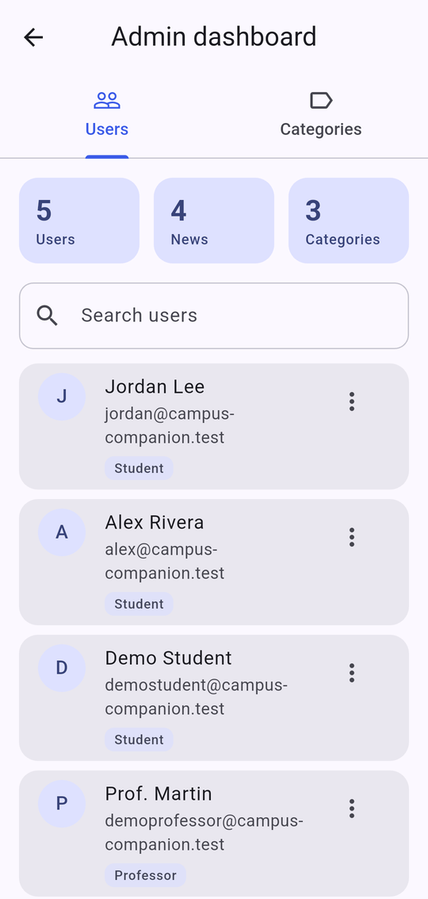</td>
    <td>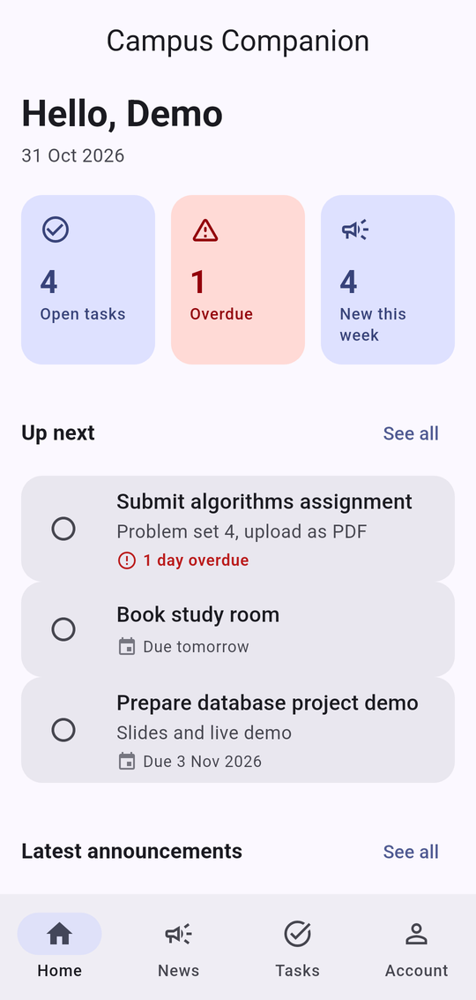</td>
  </tr>
</table>

### Account security

<table>
  <tr>
    <td>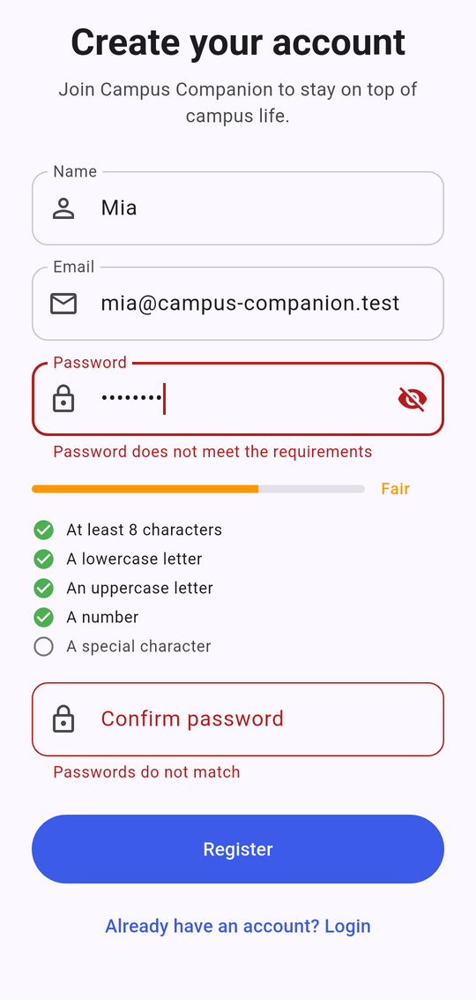</td>
    <td>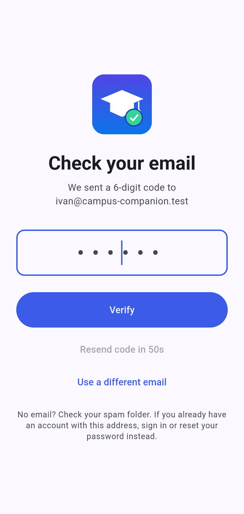</td>
    <td>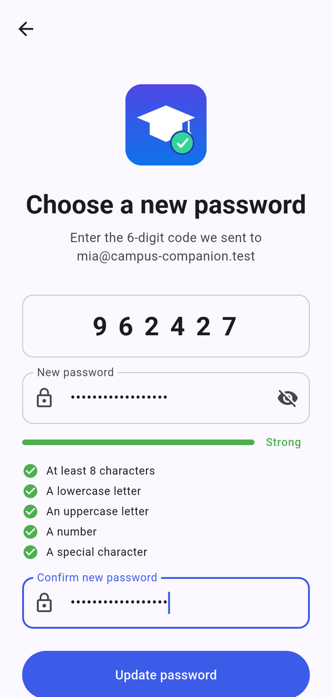</td>
  </tr>
</table>

## Architecture

The code is organised **feature-first**. Each feature owns its three layers, and dependencies only point inwards:

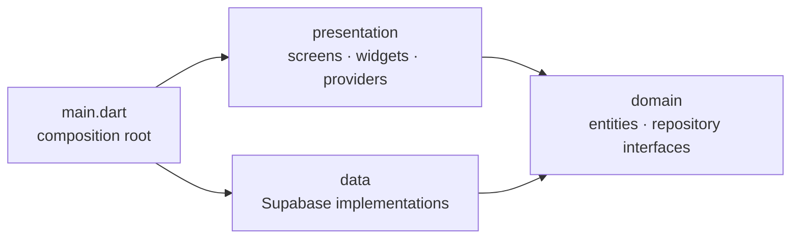

```text
lib/
├── main.dart                 # Reads the config, builds the Supabase repositories, starts the app
├── app.dart                  # Dependency injection (Provider) and MaterialApp
├── core/                     # Cross-cutting code: config, theme, routing, errors, shared widgets, utils
└── features/
    ├── auth/                 # Sign-in, registration, roles
    ├── announcements/
    ├── tasks/
    ├── categories/
    ├── admin/
    ├── home/                 # Navigation shell and dashboard
    ├── profile/
    └── settings/             # Persisted theme mode
        ├── domain/           #   pure Dart: entities and repository interfaces
        ├── data/             #   Supabase / SharedPreferences implementations
        └── presentation/     #   providers (ChangeNotifier), screens, widgets

supabase/
├── migrations/               # Schema, Row Level Security policies, SQL functions
└── tests/database/           # pgTAP tests that prove the policies hold
tool/                         # Local setup and icon generation scripts
```

Why it is built this way:

- **Testable by design.** Providers depend on repository *interfaces*, so the test-suite runs against in-memory fakes with no backend involved.
- **The backend is an implementation detail.** Nothing outside a `data/` folder imports `supabase_flutter`. Migrating from Firebase to Supabase only touched those files.
- **One loading/error strategy.** `LoadingStateMixin.runGuarded` gives every provider consistent loading and error state; expected failures are surfaced as `AppException`, everything else is replaced by a safe message.
- **Pure business rules.** Task filtering/sorting ([`task_filter.dart`](lib/features/tasks/domain/task_filter.dart)) and date wording ([`date_format.dart`](lib/core/utils/date_format.dart)) are plain functions with unit tests.

## Security model

Everything is denied by default and the [migration](supabase/migrations/20260101000000_initial_schema.sql) opens only what each role needs:

| Role | Announcements | Tasks | Categories | Users |
| --- | --- | --- | --- | --- |
| Student | read | own | read | own profile |
| Professor | read / write | own | read | own profile |
| Admin | read / write | own | read / write | read / write |

- Profiles are created by a database trigger, always as `student`; a trigger blocks anyone from changing roles or suspension unless they are an admin, and admins cannot change their own.
- Suspended users can read only their own profile, so the app can tell them why they are blocked.
- **Passwords** need 8+ characters with upper and lower case, a number and a special character. The server enforces this (`supabase/config.toml`) and the app mirrors it for instant feedback. New passwords are also checked against known breaches with the Have I Been Pwned range API: only the first 5 characters of the password's SHA-1 hash leave the device, and the check never blocks sign-up if the service is unreachable.
- **Email verification and password reset** use a 6-digit code typed into the app (templates in [`supabase/templates`](supabase/templates)), so they work on any phone without deep-link setup. Codes expire after 15 minutes and can be re-sent once a minute.
- Passwords are never stored or readable: Supabase Auth keeps only a bcrypt hash.
- **Bot protection (optional).** With a [Cloudflare Turnstile](https://www.cloudflare.com/products/turnstile/) site key the app shows a short challenge before sign-in, sign-up, resending a code and password reset, and Supabase refuses requests without a valid token. Off by default so the project runs with no external account.
- **Only an admin can delete an account**; users cannot delete their own. Deleting needs the service-role key, which must never ship in an app, so the app calls the [`admin-delete-user`](supabase/functions/admin-delete-user/index.ts) Edge Function. It verifies the caller's token, requires the admin role, refuses self-deletion, and then removes the user; the database cascades to their profile and tasks (announcements they wrote are kept).
- Announcements are saved through one SQL function so the text and its categories change atomically.
- **Photos** live in a Storage bucket that accepts only JPEG, PNG and WebP up to 5 MB, uploaded by professors and admins only; photos are shrunk to 1600 px on the device first, and the database refuses a ninth photo on an announcement. The bucket is public-read with unguessable paths, so anyone holding a link can view a photo; make it private and use signed URLs if your announcements are sensitive.
- The [pgTAP tests](supabase/tests/database/rls.test.sql) attack these rules (self-promotion, reading other people's tasks, publishing as a student, ...) and run in CI.

## Getting started

### Prerequisites

- [Flutter SDK](https://docs.flutter.dev/get-started/install) 3.24 or newer
- [Docker](https://www.docker.com/products/docker-desktop/) (runs a local Supabase) and Node 18+

### Run it locally (no account needed)

```bash
git clone https://github.com/Marzouki-Sami/campus-companion-app.git
cd campus-companion-app
flutter pub get

# 1. Start a local Supabase (Postgres + Auth + API). The first run downloads images.
npx supabase start

# 2. Write env.json and load demo accounts and sample data
node tool/setup_local.mjs

# 3. Run the app
flutter run --dart-define-from-file=env.json
```

The setup script prints the demo accounts (`demostudent@…`, `demoprofessor@…`, `demoadmin@campus-companion.test`) and a random password generated for that run; set `DEMO_PASSWORD` to choose your own. The demo accounts are already verified.

To try **sign-up and password reset** locally, open the Mailpit inbox at http://127.0.0.1:54324: every email the local stack sends lands there, including your 6-digit codes.

On a **physical Android phone**, forward the port so the phone can reach the local API: `adb reverse tcp:54321 tcp:54321`. Plain HTTP is only allowed in *debug* builds (see `android/app/src/debug/AndroidManifest.xml`).

Running without `env.json` shows a "Setup required" screen explaining the same steps.

### Use your own Supabase project

1. Create a project at [supabase.com](https://supabase.com) and run the migrations: `npx supabase link --project-ref <ref>` then `npx supabase db push`, then deploy the account-deletion function: `npx supabase functions deploy admin-delete-user`.
2. In **Authentication**, turn on *Confirm email*, set the minimum password length to 8 with lowercase, uppercase, digits and symbols required, and paste the two templates from `supabase/templates` into the *Confirm signup* and *Reset password* email templates (they show the 6-digit code through the Token variable). Configure a real SMTP provider: Supabase's built-in sender is heavily rate-limited and meant for testing only.
3. Copy `env.example.json` to `env.json` and fill in the project URL and the **publishable** key (Project Settings → API). The key is designed to ship inside the app; the policies above are what protect your data. Never put a `secret`/`service_role` key in the app.
4. *(Optional)* Bot protection: create a Turnstile widget in Cloudflare (add the hostname `localhost`), paste its **secret key** under Authentication → Attack Protection → *Enable CAPTCHA protection* in Supabase, and add `"TURNSTILE_SITE_KEY": "<site key>"` to `env.json`. To try it locally, see the commented `[auth.captcha]` block in `supabase/config.toml`.
5. Promote your first admin in the SQL editor: `update profiles set role = 'admin' where email = 'you@example.com';`. After that, roles are managed from the in-app admin dashboard.

## Testing

```bash
flutter analyze
flutter test                 # unit and widget tests, no backend needed
npx supabase start && npx supabase test db   # database policy tests
```

The Dart suite covers domain rules, row mapping, error translation, the providers (against in-memory fakes) and the login screen. [GitHub Actions](.github/workflows/ci.yml) runs formatting, analysis, the tests, a debug APK build and the database tests in parallel on every pull request.

## Build

```bash
flutter build apk --release --dart-define-from-file=env.json
```

The launcher icon is generated and reproducible: `python tool/generate_icon.py` (needs Pillow) followed by `dart run flutter_launcher_icons`.

To publish the app, follow [docs/RELEASING.md](docs/RELEASING.md). Security issues: see [SECURITY.md](SECURITY.md).

## License

Released under the [MIT License](LICENSE).
