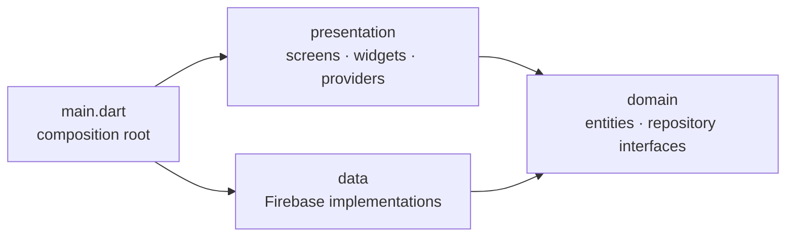

<div align="center">


# Campus Companion

**Announcements, tasks and administration for university life, in one Flutter app.**

[](https://github.com/Marzouki-Sami/campus-companion-app/actions/workflows/ci.yml)


[](LICENSE)


</div>

## Features

| Area | Highlights |
| --- | --- |
| **Dashboard** | Personal greeting, open/overdue task counters, next tasks and the latest announcements at a glance |
| **Announcements** | Category chips, full-text search, time-range filter; professors and admins can publish, edit and delete |
| **Tasks** | Due dates with relative wording ("Due tomorrow", "3 days overdue"), status and overdue filters, search, pull-to-refresh |
| **Administration** | Tabbed dashboard to manage users (role, suspension, name) and announcement categories |
| **Accounts** | Email/password authentication, profile editing, suspended accounts are blocked at sign-in and by the security rules |
| **Appearance** | Light, dark or system theme, remembered on the device |

Role-based access is enforced **server-side** by [`firestore.rules`](firestore.rules), not only in the UI: new accounts are always created as `student`, and only an admin can change a role.

## Screenshots

<table>
  <tr>
    <td></td>
    <td></td>
    <td></td>
    <td></td>
  </tr>
  <tr>
    <td></td>
    <td></td>
    <td></td>
    <td></td>
  </tr>
</table>

## Architecture

The code is organised **feature-first**. Each feature owns its three layers, and dependencies only point inwards:



```text
lib/
├── main.dart                 # Builds the Firebase repositories and starts the app
├── app.dart                  # Dependency injection (Provider) and MaterialApp
├── core/                     # Cross-cutting code: theme, routing, errors, shared widgets, utils
└── features/
    ├── auth/                 # Sign-in, registration, roles
    ├── announcements/
    ├── tasks/
    ├── categories/
    ├── admin/
    ├── home/                 # Navigation shell and dashboard
    ├── profile/
    └── settings/             # Persisted theme mode
        ├── domain/           #   pure Dart: entities and repository interfaces
        ├── data/             #   Firestore / Firebase Auth / SharedPreferences implementations
        └── presentation/     #   providers (ChangeNotifier), screens, widgets
```

Why it is built this way:

- **Testable by design.** Providers depend on repository *interfaces*, so the test-suite runs against in-memory fakes with no Firebase involved.
- **Firebase is an implementation detail.** Nothing outside a `data/` folder imports `cloud_firestore` or `firebase_auth`.
- **One loading/error strategy.** `LoadingStateMixin.runGuarded` gives every provider consistent loading and error state; expected failures are surfaced as `AppException`, everything else is replaced by a safe message.
- **Pure business rules.** Task filtering/sorting ([`task_filter.dart`](lib/features/tasks/domain/task_filter.dart)) and date wording ([`date_format.dart`](lib/core/utils/date_format.dart)) are plain functions with unit tests.

## Getting started

### Prerequisites

- [Flutter SDK](https://docs.flutter.dev/get-started/install) 3.24 or newer
- A Firebase project with **Email/Password** authentication and **Cloud Firestore** enabled
- [FlutterFire CLI](https://firebase.google.com/docs/flutter/setup): `dart pub global activate flutterfire_cli`

### Run against your Firebase project

```bash
git clone https://github.com/Marzouki-Sami/campus-companion-app.git
cd campus-companion-app
flutter pub get

# Generates lib/firebase_options.dart and the platform config files (all git-ignored)
flutterfire configure

flutter run
```

Firebase configuration is intentionally **not** committed. The `*.example` files show the expected shape of `google-services.json`, `GoogleService-Info.plist` and `firebase_options.dart`.

Deploy the security rules with `firebase deploy --only firestore:rules`. The first admin has to be promoted by editing the `role` field of a `users/{uid}` document in the Firebase console; after that, roles are managed from the in-app admin dashboard.

### Run with the Firebase Emulator (no cloud project needed to try it)

The app can talk to the local [Firebase Emulator Suite](https://firebase.google.com/docs/emulator-suite), which also loads and tests [`firestore.rules`](firestore.rules). It needs **JDK 21+** and Node 18+.

```bash
# 1. Start Auth + Firestore emulators
npx firebase-tools emulators:start --config firebase.emulator.json \
  --project <projectId> --only auth,firestore

# 2. Load demo accounts and sample data (<projectId> is the one in lib/firebase_options.dart)
node tool/seed_emulator.mjs <projectId>

# 3. Run the app against the emulators
flutter run --dart-define=USE_FIREBASE_EMULATOR=true
```

Sign in with `demostudent@campus-companion.test`, `demoprofessor@…` or `demoadmin@…`. The seed script generates a random password on every run and prints it (set `DEMO_PASSWORD` to choose your own).

On a **physical Android device** the emulators must be reachable over your network: set `"host": "0.0.0.0"` for `auth` and `firestore` in a copy of `firebase.emulator.json`, then add `--dart-define=EMULATOR_HOST=<your computer's LAN IP>` to `flutter run`. Plain HTTP is only allowed in *debug* builds (see `android/app/src/debug/AndroidManifest.xml`).

## Roles

| Role | Announcements | Tasks | Categories | Users |
| --- | --- | --- | --- | --- |
| Student | read | own | read | own profile |
| Professor | read / write | own | read | own profile |
| Admin | read / write | own | read / write | read / write |

## Testing

```bash
flutter analyze
flutter test
```

The suite covers the domain rules, the providers (against in-memory fakes) and the login screen. [GitHub Actions](.github/workflows/ci.yml) runs formatting, analysis, tests and a debug APK build on every pull request.

## Build

```bash
flutter build apk --release
```

The launcher icon is generated and reproducible: `python tool/generate_icon.py` (needs Pillow) followed by `dart run flutter_launcher_icons`.

## License

Released under the [MIT License](LICENSE).
